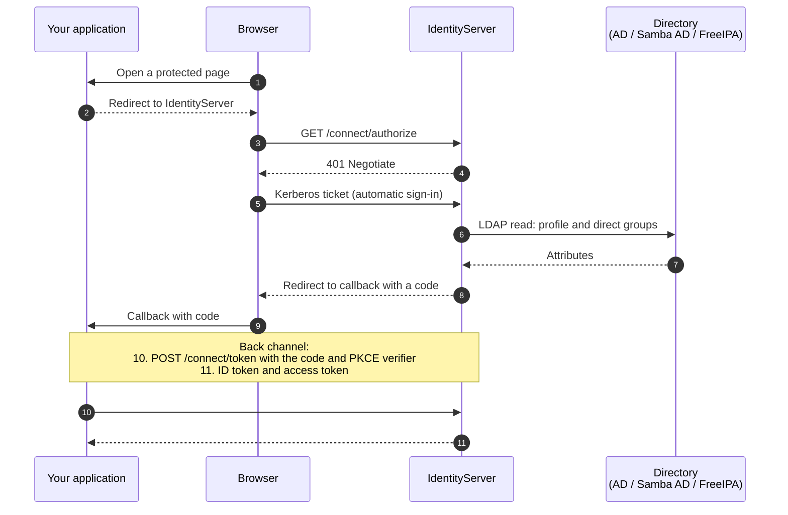

# IdentityServer

An OpenID Connect server that signs people in with their Active Directory, Samba AD or FreeIPA
accounts, built on ASP.NET Core 10 and OpenIddict.




The operating system's Negotiate handler, or a Kerberos-authenticating Apache or Nginx proxy,
verifies the browser's Kerberos ticket. IdentityServer then reads the person's profile and direct
group memberships from the directory and issues an ID token and an access token to the
application.

- **Sign-in.** A browser that trusts the identity hostname and holds a Kerberos ticket signs in
  without a prompt. Integrated authentication is the only sign-in method.
- **Endpoints and flows.** Discovery, JWKS, authorization and token endpoints. The server accepts
  the authorization code flow, with PKCE when the client sends it, and the implicit and hybrid
  flows. It issues no refresh tokens: the application starts a new sign-in to get fresh tokens.
- **Claims.** A subject that survives renames (the Windows SID, or the FreeIPA `ipaUniqueID`),
  display name, email, given name, surname and phone, and one `role` claim for each direct group
  whose name matches the `Groups` setting.
- **Hosting.** Run the standalone server on Windows or Linux, or add the sign-in endpoints to
  your own ASP.NET Core application with the `AurorisNet.IdentityServer` package.
- **People lookup.** The `AurorisNet.IdentityServer.Directory` package searches Active Directory
  for address books and people pickers.

## Install

**Standalone server.** Download the Windows or Linux archive from the
[releases page](https://github.com/auroris/AurorisNet.IdentityServer/releases); it includes the
.NET runtime ([what the archives contain](docs/releasing.md)). Or publish from a checkout with
the .NET 10 SDK:

```powershell
dotnet publish IdentityServer.csproj -c Release -o artifacts/publish
```

That output needs the ASP.NET Core 10 runtime on the server, or the Hosting Bundle under IIS.
Then follow the guide for your host under [Hosting](#hosting).

**Embedded.** Add the package to a .NET 10 ASP.NET Core application and follow
[Embedding the core](docs/embedding.md):

```shell
dotnet add package AurorisNet.IdentityServer
```

| Package | Adds |
|---|---|
| `AurorisNet.IdentityServer` | The sign-in endpoints, directory providers and host builder, for your own application. |
| `AurorisNet.ActiveDirectory` | Wrappers over `System.DirectoryServices` for users, groups, computers and printers. Windows only. |
| `AurorisNet.IdentityServer.Directory` | People and group lookup over Active Directory. Windows only. Published in releases after 1.1.1. |

### Run it locally

On Windows with the .NET 10 SDK, start the server with the demonstration settings in the
repository:

```powershell
dotnet run --project IdentityServer.csproj --no-launch-profile -- --urls http://localhost:5000
```

Open <http://localhost:5000/.well-known/openid-configuration>. A JSON document with `issuer`,
`authorization_endpoint` and `token_endpoint` shows that the server runs. The root URL returns 404.
To complete a browser sign-in, follow
[Checking a sign-in with oidcdebugger.com](docs/verification.md#checking-a-sign-in-with-oidcdebuggercom).

## Hosting

| Host | Who authenticates the browser | Directory | Guide |
|---|---|---|---|
| Windows Server, IIS | IIS Windows Authentication | Active Directory, through the server's domain membership | [Windows and IIS](docs/windows-iis.md) |
| Windows Server, Kestrel | The server, with Negotiate | Active Directory | [Windows and IIS](docs/windows-iis.md#hosting-with-kestrel) |
| Linux, Kestrel | The server, from an HTTP keytab | Active Directory, Samba AD or FreeIPA | [Linux](docs/linux-deployment.md) |
| Linux, Apache | mod_auth_gssapi, which passes the principal in a trusted header | Active Directory, Samba AD or FreeIPA | [Linux](docs/linux-deployment.md), [Apache and Nginx](docs/apache-and-nginx.md) |
| Linux, Nginx | The SPNEGO module, which passes the principal in a trusted header | Active Directory, Samba AD or FreeIPA | [Linux](docs/linux-deployment.md), [Apache and Nginx](docs/apache-and-nginx.md) |

A Windows host can also read Samba AD or FreeIPA with the LDAP settings Linux uses.

Deploy on an intranet where browsers can reach a domain controller or IPA server for Kerberos
tickets. Serve the identity hostname over HTTPS.

## Settings

Settings live in the `IdentityServer` section of `appsettings.json`.
[Configuration](docs/configuration.md) describes each one in full.

| Setting | Default | What it does |
|---|---|---|
| `ServerUri` | `*` | The issuer: the public base URL, including any application path. With `*` or no value, each request's URL supplies the issuer. Set it in production. |
| `Hosts` | none | Origins that may receive sign-in results and call the token endpoint from a browser. **The redirect check compares the hostname only.** With no entries, every authorization request is rejected. |
| `Clients` | none | The applications that may request sign-in: a `ClientId` and, for a confidential client, a `ClientSecret`. **With no entries, any client ID is accepted.** |
| `Groups` | none | Regular expressions matched against the common names of a person's direct groups. Each match becomes a `role` claim. |
| `PersistKeys` | `false` | Keeps the signing and encryption keys across restarts. With `false`, each start creates new keys, and codes and tokens issued earlier stop working. |
| `DataPath` | `keys` in the application folder | The folder that holds the two key files. |
| `KeyProtectionPassword` | none | Encrypts the key files with a password. Required on Linux. Windows uses machine-scoped DPAPI when it is omitted. |
| `AccessTokenLifetime`, `IdentityTokenLifetime`, `AuthorizationCodeLifetime` | OpenIddict's defaults | Lifetimes as `hours:minutes:seconds`. |
| `Authentication:Mode` | `Auto` | `Negotiate`, `Kerberos` or `ProxyKerberos`. `Auto` selects `Negotiate` on Windows and `Kerberos` on Linux or with FreeIPA. |
| `Directory` | `Provider`: `Auto` | The directory connection. `Auto` selects the `Windows` provider on Windows when no `Server` is set, and `ActiveDirectory` otherwise. See [Directory providers](docs/kerberos-and-ldap.md). |
| `UseForwardedHeaders`, `ReverseProxy`, `PathBase`, `PathBaseMode`, `Authentication:ProxySecret` | off | Reverse-proxy hosting. See [Apache and Nginx](docs/apache-and-nginx.md#application-configuration). |

The `appsettings.json` in the repository holds demonstration values: a client named `optional`
and the callback hosts `localhost` and `oidcdebugger.com`. Replace them before you deploy.

## Supported versions

| Component | Supported |
|---|---|
| Runtime | .NET 10 with ASP.NET Core 10 |
| OpenIddict | 7 |
| Server hosts | Windows with IIS or Kestrel. Linux with Kestrel, Apache or Nginx. |
| Directories | Microsoft Active Directory, Samba AD, FreeIPA |
| `AurorisNet.ActiveDirectory`, `AurorisNet.IdentityServer.Directory` | Windows |

## Documentation

| Guide | What it covers |
|---|---|
| [How it works](docs/how-it-works.md) | The sign-in sequence, the three credentials involved, and what the server stores. |
| [Configuration](docs/configuration.md) | Where settings come from, every `IdentityServer` setting, and the flows, scopes and claims. |
| [Directory providers](docs/kerberos-and-ldap.md) | The `Directory` settings for Active Directory, Samba AD and FreeIPA, and how a person is matched to an account. |
| [Windows and IIS](docs/windows-iis.md) | Deploying under IIS or Kestrel on Windows: the site, service principal names, browser trust and updates. |
| [Linux](docs/linux-deployment.md) | Deploying on Linux step by step: Kerberos, keytabs, certificates, systemd and browser sign-in. |
| [Apache and Nginx](docs/apache-and-nginx.md) | The proxy templates, how the server trusts the proxy, and path prefixes. |
| [Verification](docs/verification.md) | The checks for a new deployment, a sign-in walkthrough, and the tests. |
| [Troubleshooting](docs/troubleshooting.md) | The log messages of a sign-in in order, and known failures with their fixes. |
| [Embedding the core](docs/embedding.md) | Hosting the endpoints in your own application, and using the two library packages alone. |
| [Release assets](docs/releasing.md) | The files in a release and how to run the self-contained archives. |

[`deploy/`](deploy/) holds the Linux templates: settings and systemd units for Kestrel and for a
proxy backend, and the Apache and Nginx site files.

## Developing

You need the .NET 10 SDK on Windows or Linux.

```powershell
dotnet build IdentityServer.sln --configuration Release
dotnet test IdentityServer.sln --configuration Release --filter 'Category!=LiveDirectory'
dotnet pack ActiveDirectory/ActiveDirectory.csproj --configuration Release --output artifacts/nuget
dotnet pack IdentityServer.Core/IdentityServer.Core.csproj --configuration Release --output artifacts/nuget
dotnet pack IdentityServer.Directory/IdentityServer.Directory.csproj --configuration Release --output artifacts/nuget
```

Tests in the `LiveDirectory` category read a real directory, so they run on a developer's machine
and never on GitHub:

```powershell
dotnet test IdentityServer.sln --configuration Release --filter 'Category=LiveDirectory'
```

They skip on a machine that is not signed in to a reachable domain.
[Live directory tests](docs/verification.md#live-directory-tests) describes the LDAP test's
environment variables.

| Project | Contents |
|---|---|
| `IdentityServer.csproj` | The standalone host and demonstration settings. |
| `IdentityServer.Core` | Authentication, directory providers, OpenIddict setup and the host builder. Package `AurorisNet.IdentityServer`. |
| `ActiveDirectory` | The `System.DirectoryServices` wrappers. Package `AurorisNet.ActiveDirectory`. |
| `IdentityServer.Directory` | The people and group lookup. Package `AurorisNet.IdentityServer.Directory`. |
| `tests/` | The tests of the server and of the lookup. |

## Releases

IdentityServer follows OpenIddict. Dependabot checks NuGet each day and opens one pull request
for the OpenIddict packages. `ci.yml` tests it on Windows and Linux, merges it and starts
`release.yml`. Versions are `MAJOR.MINOR.PATCH`: a minor OpenIddict update raises the minor
number and any other update raises the patch number. One release publishes the Windows and
Linux archives, the three NuGet packages and `SHA256SUMS.txt`, listed in
[Release assets](docs/releasing.md). The
[release guide](https://github.com/auroris/AurorisNet.Build/blob/main/docs/releasing.md)
describes the automation and how to start a release by hand.

## License

[MIT](LICENSE)
