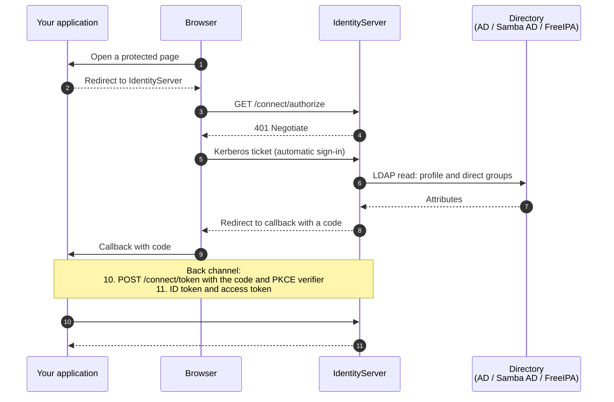

<h1 align="center">IdentityServer</h1>

<p align="center">
   An OpenID Connect server for the directory you already run, built on ASP.NET Core and OpenIddict. Run standalone or embed in your application.
</p>

<p align="center">
  <a href="LICENSE"></a>
  
  
  
  
  
</p>



## What it is

IdentityServer is an ASP.NET Core 10 service, built on
[OpenIddict](https://documentation.openiddict.com/), that bridges an existing Active
Directory domain, Samba AD domain or FreeIPA realm to OpenID Connect applications.
The operating system's Kerberos handler, or a Kerberos-aware Apache or Nginx proxy,
authenticates the user. IdentityServer reads
their profile and group memberships from the directory and issues tokens to the application.

- **Directory accounts.** People use their existing intranet sign-in. A browser that trusts
  the identity hostname and holds a Kerberos ticket signs in automatically.
- **Standard OpenID Connect.** Discovery, JWKS, authorization and token endpoints.
  Authorization code with PKCE is the recommended flow; implicit and hybrid are available
  for older clients.
- **Claims from the directory.** A stable subject (the Windows SID or FreeIPA `ipaUniqueID`),
  display name, email, given name, surname and phone, plus one `role` claim per direct
  group membership that matches your allowlist.
- **Three directories.** Microsoft Active Directory, Samba AD and FreeIPA, read over LDAPS
  or StartTLS with a dedicated read account or the service's own Kerberos credentials.
- **Windows and Linux hosting.** Windows with IIS or Kestrel; Linux with Kestrel, or behind Apache
  or Nginx with the proxy doing the Kerberos handshake.
- **Configuration and identity checks.** Authentication and directory settings are validated
  at startup. Directory lookups must resolve to exactly one account.
- **Folder deployment.** Publish the application to a folder, configure it in
  `appsettings.json`, and persist its two token keys. Logs go to the console and daily files.
- **Embeddable.** Reference the core library from your own ASP.NET Core application to host
  sign-in beside your own endpoints.

> [!NOTE]
> "IdentityServer" here is this project's assembly and configuration-section name. It is
> not related to Duende IdentityServer.

## Supported configurations

Choose the row that matches your environment.

| Host | Who authenticates the browser | Directory | Guide |
|---|---|---|---|
| Windows Server, IIS | IIS Windows Authentication | Active Directory through the server's domain membership | [Windows and IIS](docs/windows-iis.md) |
| Windows Server, Kestrel | The service itself (Negotiate) | Active Directory | [Windows and IIS](docs/windows-iis.md#hosting-with-kestrel) |
| Linux, Kestrel | The service itself, from an HTTP keytab | Active Directory, Samba AD or FreeIPA | [Linux](docs/linux-deployment.md) |
| Linux, Apache | mod_auth_gssapi, then a trusted proxy header | Active Directory, Samba AD or FreeIPA | [Linux](docs/linux-deployment.md), [Apache and Nginx](docs/apache-and-nginx.md) |
| Linux, Nginx | The SPNEGO module, then a trusted proxy header | Active Directory, Samba AD or FreeIPA | [Linux](docs/linux-deployment.md), [Apache and Nginx](docs/apache-and-nginx.md) |

A Windows host can also read Samba AD or FreeIPA through the same LDAP settings Linux uses.

> [!WARNING]
> Deploy IdentityServer on an intranet where browsers can reach a domain controller or IPA
> server for Kerberos tickets. Use HTTPS and explicit client and callback settings. Its
> sign-in flow relies on directory authentication; password sign-in, multi-factor
> authentication and account self-service require a separate solution.

## Quick start

This check runs on a Windows machine with the .NET 10 SDK and confirms that the server
builds, starts and publishes its discovery document. It uses the demonstration settings in
the repository, which accept a test client called `optional`.

```powershell
dotnet restore IdentityServer.sln
dotnet test IdentityServer.sln
dotnet run --project IdentityServer.csproj --no-launch-profile -- --urls http://localhost:5000
```

Open [http://localhost:5000/.well-known/openid-configuration](http://localhost:5000/.well-known/openid-configuration).
A JSON document with `issuer`, `authorization_endpoint` and `token_endpoint` means hosting
works. Discovery is anonymous; the root URL returns 404. Tests that need a live domain skip
when a domain is unavailable.

To complete a browser sign-in, follow [Checking a sign-in with oidcdebugger.com](docs/verification.md#checking-a-sign-in-with-oidcdebuggercom).
On a domain-joined machine the browser signs in silently; on a workgroup machine the local
account still works, with fewer claims.

To publish a deployable folder:

```powershell
dotnet publish IdentityServer.csproj -c Release -o artifacts/publish
```

The output is framework-dependent and needs the ASP.NET Core 10 runtime (or the Hosting
Bundle for IIS) on the destination. Then follow the guide for your row in the table above.

## Documentation

| Guide | Read it for |
|---|---|
| [How it works](docs/how-it-works.md) | The sign-in sequence, credentials, storage and application session lifecycle. |
| [Windows and IIS](docs/windows-iis.md) | Prerequisites, publishing, the IIS site and authentication settings, key persistence, SPNs, sub-applications, Kestrel on Windows, and updates. |
| [Linux](docs/linux-deployment.md) | From packages to a verified browser sign-in: DNS and Kerberos, keytabs for AD, Samba and FreeIPA, certificates, the service account, systemd, and troubleshooting. |
| [Apache and Nginx](docs/apache-and-nginx.md) | The proxy templates, how the backend trusts the proxy, paths and prefixes, and the checks to run before going live. |
| [Directory providers](docs/kerberos-and-ldap.md) | Choosing between Windows, Active Directory, Samba AD and FreeIPA; every `Directory` setting; how accounts are matched; token-key persistence. |
| [Configuration](docs/configuration.md) | Where settings come from, a complete example, every `IdentityServer` key, and the flows, scopes and claims the server issues. |
| [Verification](docs/verification.md) | The checks to run on a new deployment, a sign-in walkthrough with oidcdebugger.com, and the automated and live test suites. |
| [Troubleshooting](docs/troubleshooting.md) | Reading the logs stage by stage, and the known failure modes with their fixes. |
| [Embedding the core](docs/embedding.md) | Hosting the sign-in endpoints inside your own ASP.NET Core application, and using the Active Directory wrapper library on its own. |
| [Creating a release](docs/releasing.md) | Versioning and publishing Windows/Linux releases and the embeddable NuGet packages with Trusted Publishing. |

Ready-to-adapt deployment templates live in [`deploy/`](deploy/): settings and systemd
units for native Kestrel and for a proxy backend, plus Apache and Nginx site files.

## Developing

```powershell
dotnet restore IdentityServer.sln
dotnet build IdentityServer.sln -c Release
dotnet test IdentityServer.sln -c Release
```

The prerequisite is the .NET 10 SDK on Windows or Linux. The suite runs without a domain:
tests that need a live directory skip themselves, and the opt-in live LDAP test is described
in [Verification](docs/verification.md#live-directory-tests). The solution holds three
projects: `IdentityServer` (the standalone host), `IdentityServer.Core` (the reusable
library) and `ActiveDirectory` (a Windows-only wrapper over `System.DirectoryServices`).

## License

[MIT](LICENSE)
